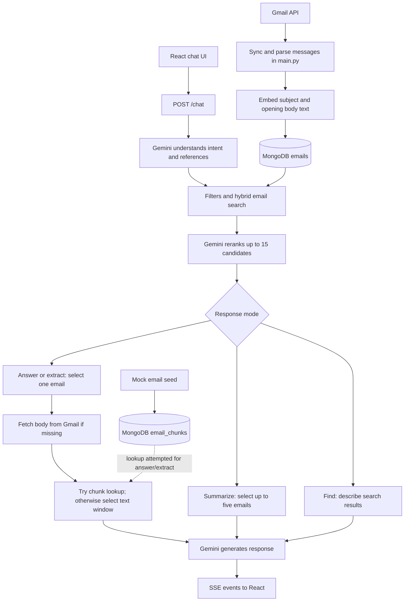

# Understanding Mail Sherlock's current RAG architecture

This guide explains the code as it exists on 2026-11-08, before implementing `PLAN-RAG.md`. Examples illustrate behavior; they are not measured model outputs. The implementation plan describes the intended future system, while this document describes the current one and the knowledge needed to change it confidently.

## 1. What RAG means here

**Retrieval-Augmented Generation** combines two jobs:

1. Retrieve email content relevant to a question.
2. Give that content to a language model so it can generate an answer.

For example, for “What is the payment deadline in the Acme invoice?”, the system first finds likely emails, selects email text, and asks Gemini to answer using that text.

Your emails are external context supplied at request time. This process does not train Gemini on your mailbox or update its model weights. An embedding is another representation of text used to find related content; it is not an answer.

The project also supports searching without answering. `/ask` returns search results. `/chat` adds intent routing and generated responses.

## 2. The architecture at a glance



Important: the chunk store is currently populated by mock seeding, not by the Gmail sync paths. The diagram therefore does not connect Gmail sync to `email_chunks`. There is also a partition mismatch that prevents normal answer/extract calls from finding those chunks reliably; section 9 explains it.

Chitchat and clarification take shorter routes and do not run retrieval. Some answer/extract follow-ups reuse earlier result IDs instead of doing a new search.

## 3. Where to read the code

| File | Role | Start with |
| --- | --- | --- |
| `backend/main.py` | API routes, Gmail sync, search, chat orchestration | `_raw_message_to_doc`, `_semantic_search`, `_chat_stream` |
| `backend/embeddings.py` | Text-to-vector conversion and similarity | `encode`, `add_embeddings_inplace`, `cosine_similarity` |
| `backend/agent_search.py` | Query understanding and LLM reranking | `understand_query_async`, `rerank_async`, `_fallback` |
| `backend/chunk_index.py` | Body chunks, stored vectors, within-email chunk lookup | `_split_body_chunks`, `rebuild_chunks_for_emails`, `merged_chunk_body_for_query` |
| `backend/passage_select.py` | Cheap lexical passage selection | `extract_relevant_passage`, `body_for_llm` |
| `backend/agent.py` | Prompts and response generation | `answer_prompt`, `extract_prompt`, `summarize_prompt`, `stream_call` |
| `backend/db.py` | MongoDB connection | `connect_db`, `get_db` |
| `backend/reader.py` | Reader HTML sanitization and text extraction | `get_email_for_reader`, `extract_plain_text` |
| `web/src/pages/Dashboard.tsx` | Chat requests, streamed responses, selected email | Search for `active_email_id` and stream event handling |
| `web/src/types.ts` | Frontend response shapes | `EmailResult`, `AgentMode`, `SearchResponse` |

`main.py` currently owns much of the RAG behavior. Reading only `agent.py` misses retrieval, filtering, reference resolution, and Gmail body fetching.

## 4. Ingestion: preparing mail before a search

Ingestion means turning provider data into searchable records.

### 4.1 Fetch and normalize

Bulk and incremental sync use the Gmail API to list message IDs and fetch messages. `_raw_message_to_doc` extracts fields such as:

```python
{
    "id": "provider-message-id",
    "threadId": "provider-thread-id",
    "subject": "Acme invoice",
    "sender": "Billing <billing@example.com>",
    "date": "email date header",
    "snippet": "short provider preview",
    "body": "opening message text",
    "accountEmail": "connected-account@example.com",
    "isUnread": True,
    "hasAttachment": False,
}
```

`owner_session` is added for ownership scoping. It is different from `accountEmail`: one session can have multiple connected mail accounts.

The present normalization path truncates the parsed body to **2,000 characters**. It prefers plain text when walking MIME parts, but does not provide a complete HTML-only multipart fallback. MIME is the structure that lets one email contain plain text, HTML alternatives, nested sections, and attachments.

### 4.2 Create embeddings

`add_embeddings_inplace` creates two vectors per email:

- `emb_subject`: the subject text.
- `emb_body`: the first 1,000 characters of the body.

The actual model is `all-MiniLM-L6-v2`, producing **384-dimensional** normalized vectors. Comments mentioning BGE and 768 dimensions are stale.

“384-dimensional” means each text becomes an array of 384 numbers. Semantically related text should have vectors pointing in similar directions. The numbers are learned features, not individually readable labels such as “invoice” or “deadline.”

Normalization makes each vector's length approximately one, which permits a dot product to act as cosine similarity.

### 4.3 Store records

The Gmail sync paths compute embeddings and smart labels, then remove `body` before writing email records to MongoDB. As a result, normal Gmail search operates on stored metadata, previews, and opening-body vectors. It does not have a persistent full body available for lexical search or reranking.

The complete body can be fetched later from Gmail for a selected email. That helps answer generation after selection, but cannot recover an email that search failed to select in the first place.

**Lesson:** ingestion quality sets an upper bound on retrieval quality. A later language model cannot rank evidence it never receives.

## 5. Query understanding: translating a user message into a search

`understand_query_async` sends the latest question and prior chat text to Gemini. Its configured model is `gemini-2.5-flash`.

It asks for JSON describing the user's intent. For example:

```json
{
  "mode": "extract",
  "search_query": "Acme invoice payment due date deadline",
  "keywords": ["Acme", "invoice"],
  "sender": null,
  "date_hint": null,
  "search_focus": "body",
  "extract_field": "deadline",
  "uses_prior_context": false,
  "context_ref": null,
  "needs_clarification": false
}
```

These fields have different purposes:

| Field | Purpose |
| --- | --- |
| `mode` | Choose find, answer, summarize, extract, or chitchat |
| `search_query` | Resolve references and expand wording for retrieval |
| `keywords` | Add score boosts for matching terms; currently not mandatory constraints |
| `sender`, `date_hint` | Narrow the candidate set |
| `search_focus` | Change subject/body vector weights |
| `uses_prior_context`, `context_ref` | Reuse an earlier result or selected email |
| `needs_clarification` | Ask a question instead of searching |

If Gemini is unavailable or returns unusable output, `_fallback` uses simple regex rules. That fallback defaults to `find`; it is not equivalent to full intent understanding.

Learn to distinguish **query rewriting** from **retrieval**: the first creates a search description, while the second looks for actual records. A good rewrite still needs a working index.

## 6. Retrieval: finding candidate emails

`_semantic_search` performs the main retrieval pipeline.

### 6.1 Load and filter

It loads up to 1,000 email records belonging to the current session, then applies client filters and intent hints in Python.

Current caveats:

- The limit applies before filtering, without an explicit sort.
- Sender, date, unread, and attachment filters retain the previous candidates if the filtered result is empty.
- The `last_30_days` request field is not applied.

These are correctness issues, not normal RAG requirements. A hard filter should define the eligible corpus even when it leaves zero messages.

### 6.2 Dense semantic score

The query is embedded with the same embedding model as the email fields. Using the same model and representation version matters because vectors from incompatible models cannot be meaningfully compared.

The code computes dot products between the query vector and each email's vectors. It then weights the fields:

| Focus | Subject weight | Body weight |
| --- | --- | --- |
| `subject` | 0.8 | 0.2 |
| `body` | 0.2 | 0.8 |
| `any` | 0.5 | 0.5 |
| `sender` | 1.0 | 0.0; sender filtering is expected to have happened already |

If legacy records lack the expected subject embeddings, the fallback embeds a constructed text with repeated subject, sender, and the first 500 body characters. The readiness check currently validates only `emb_subject`, so malformed/missing `emb_body` can still break the normal scoring path.

### 6.3 Lexical score with BM25

BM25 scores word matches using term frequency, document length, and how common a term is in the corpus. It is useful for exact terms such as names and order numbers that semantic similarity may blur.

The current lexical corpus is **subject + snippet**, tokenized by lowercasing and splitting on whitespace. It does not index the full email body. Punctuation and identifier formatting therefore affect exact matches.

### 6.4 Combine scores

The current approximate formula is:

```text
hybrid = 0.7 × (semantic score / largest semantic score)
       + 0.3 × (BM25 score / largest BM25 score)
       + 0.15 for each matching extracted keyword
```

The keyword boost checks subject and stored body. For normally synced Gmail records, the stored body has been removed.

These scores indicate relative ranking within this candidate set. They are **not probabilities**. A score of 0.9 does not mean “90% likely correct.” Dividing by the largest score can make a weak best match look strong, and negative-score cases also need care.

The BM25 cache currently uses session and candidate count to decide reuse. Different filtered sets of equal size can therefore receive stale scores aligned to the wrong records.

### 6.5 Shortlist and rerank

The code takes up to **15** hybrid-ranked emails and sends short descriptions to Gemini for reranking. Each description contains subject, sender, date, and a query-relevant passage of roughly 400 characters.

`rerank_async` returns the top requested number, normally five. It can skip the model call when the first score is sufficiently ahead and no keywords are present. Missing/invalid ranking output falls back to the original order.

The reranker can rearrange the shortlist but cannot recover emails outside it. It is also prompted to rank all candidates, rather than reject all of them when none are relevant.

**Lesson:** retrieval recall comes before ranking quality. Recall asks whether the right evidence enters the shortlist at all.

## 7. Conversation state: deciding which email the user means

The frontend sends chat messages, filters, an optional open email ID, and a context snapshot. The context contains previous result IDs, an active email ID, mode, and a key derived from filter settings and `top_k`.

There are three different kinds of context:

1. **Conversation text:** earlier user/assistant messages, supplied to intent understanding.
2. **Selection state:** previous result IDs and the open email, used to resolve “the second one.”
3. **Evidence text:** actual email passages supplied to answer generation.

They are not interchangeable. A previous assistant statement is not proof of what an email says.

For answer/extract follow-ups, the backend can fetch prior result IDs instead of searching again. However, `active_email_id` currently overrides explicit ordinal references. “Explain the second email” can target the open first email.

Find and summarize normally run a fresh search even when prior context is mentioned. Broad conversational behavior therefore varies by mode.

Although several synchronous agent functions accept a `conversation` argument, their generation prompts do not actually include that history. The streaming answer prompts likewise receive a question and email, not the full conversation. History-aware intent parsing does not automatically make generation history-aware.

## 8. Generation: what each mode actually does

The streaming `/chat` route calls the prompt builders in `agent.py`, followed by `stream_call`. Its configured generation model is `gemini-2.5-flash-lite`.

| Mode | Evidence used | Behavior |
| --- | --- | --- |
| Find | Candidate subjects, senders, dates, previews | Short introduction to matching results |
| Answer | One selected email, with passage augmentation | Answer a specific question |
| Extract | One selected email, with passage augmentation | Return a requested field |
| Summarize | Up to five selected emails, or the open email | Summarize passage-selected bodies |
| Chitchat | User message | Short conversational reply |
| Clarify | No retrieved evidence | Ask for missing query detail |

Answer/extract fetch a missing body from Gmail on demand. Summarize also enriches missing bodies before building its prompt.

Extraction uses the full question during passage selection, but the final prompt receives only the generic extraction field, such as `amount`. That loses distinctions like deposit versus total.

The answer system prompt says to avoid guessing when evidence is missing and suggests citing relevant parts. This is a useful instruction, but there is no structured source contract or citation verification. Returning an email card is not the same as proving that every answer claim is supported by that email.

There are older synchronous helpers, including a separate find-ranking parser and `synthesize_answer`. Do not assume they describe the active UI path: `/chat` primarily uses the asynchronous orchestration and prompt builders.

## 9. Passage selection and the chunk subsystem

### 9.1 Why select passages?

A model has a limited input window, and sending entire long emails increases cost and noise. A context builder selects useful evidence within that budget. This project mainly budgets characters; model limits are in tokens, so character counts are only an approximation.

### 9.2 Sliding-window fallback

`extract_relevant_passage` slides a character window through text and counts query-word substring matches. It is a cheap lexical heuristic, not embedding search.

`body_for_llm` returns short messages whole. For longer messages, it normally combines a relevant primary window with a tail section intended to retain signatures or contact details. Answer/extract fallback uses a 5,200-character cap; summary prompt construction uses a 2,400-character cap per email.

A generic request such as “summarize this” provides little useful vocabulary for lexical window selection. Consequently, selecting one matching window can omit important facts elsewhere in the message.

### 9.3 Stored chunk retrieval

`chunk_index.py` splits bodies into 480-character chunks with a 240-character stride. Adjacent chunks overlap by 240 characters. Each gets a vector plus message identity and source offset.

Lookup retrieves chunks for **one already selected email**, scores them against the question, selects up to 14, sorts them into source order, and concatenates them within 5,200 characters.

This is within-email evidence selection. It is not corpus-wide chunk retrieval and cannot discover another email containing a more relevant passage.

### 9.4 Why this path currently misses evidence

- Only mock seeding invokes chunk rebuilding. Gmail sync does not.
- Chunks are normally partitioned by `owner_session`. `_fetch_email_doc` removes that field before chunk lookup, which then chooses the account partition or an empty partition instead.
- Chunking stops after 80 chunks, covering at most the opening 19,440 characters for a nonempty continuous body.
- A whitespace-only chunk stops chunking instead of advancing to later content.
- Sorting the top chunks before applying the output budget can discard the strongest later chunk.
- Overlapping chunks are concatenated without merging duplicate spans.

The normal Gmail answer path therefore relies on fetching the selected email body and applying the sliding-window fallback.

## 10. Streaming and the frontend

`/chat` returns Server-Sent Events (SSE), a sequence of server-to-client events over an HTTP response:

```text
thinking -> meta -> token -> token -> ... -> done
```

`meta` includes mode, result cards, intent, and conversation context. `token` carries generated text fragments. The frontend displays progress and updates the response as fragments arrive.

Streaming improves perceived responsiveness; it does not improve retrieval accuracy. It also introduces failure cases: a provider can fail after emitting part of a response. The current fallback can append a fresh synchronous response after partial streamed text, and a missing provider can lead to completion without useful generated text.

`async` allows the server to await network work without holding up unrelated requests. CPU-heavy embedding calls inside asynchronous request code can still block the event loop; writing `async def` does not automatically move computation to another thread.

## 11. Walk through one question

Suppose the user asks: “What is the payment deadline in the Acme invoice?”

1. `Dashboard.tsx` posts the messages and selection/filter context to `/chat`.
2. `_chat_stream` emits `thinking` and calls intent understanding.
3. Intent may choose `extract`, rewrite the query, and set `extract_field` to `deadline`.
4. If this is a new query, `_semantic_search` loads session emails and applies filters.
5. MiniLM measures query similarity to subject/body vectors. BM25 adds lexical subject/snippet scores, then keyword boosts are applied.
6. Up to 15 candidates enter Gemini reranking; normally five are returned.
7. The backend chooses one email, potentially overridden by the open email ID.
8. It fetches a missing body from Gmail.
9. It attempts chunk lookup, normally falls back to lexical passage selection, and creates the extraction prompt.
10. Gemini generates the field value; SSE delivers it to the browser alongside result metadata.

Possible failure points follow the same order: missing indexed content, wrong filters, poor initial recall, a missed reranking candidate, wrong reference resolution, omitted evidence, or an unsupported generated answer. This sequence is a useful debugging checklist.

## 12. What to learn, in a practical order

| Stage | Learn | Connect it to this repo | Exercise |
| --- | --- | --- | --- |
| 1 | Python dictionaries, functions, dataclasses, type hints | Email records and `AgentResponse` | Trace one record's fields from sync to response |
| 2 | HTTP, FastAPI, JSON, Pydantic | `/ask`, `/chat`, request models | Describe the request/response contract for each route |
| 3 | `async`/`await`, event loops, worker threads, SSE | `_chat_stream`, `stream_call`, sync workers | Mark which operations wait on networks versus use CPU |
| 4 | MongoDB queries, projections, indexes, ownership | `owner_session`, email/chunk lookups | Explain why projecting out a partition field breaks lookup |
| 5 | MIME, HTML-to-text, chunking, offsets | Ingestion and `chunk_index.py` | Normalize a synthetic multipart message and find its evidence span |
| 6 | Embeddings, vector dimensions, cosine similarity | `embeddings.py` | Compare a paraphrase, an exact ID, and an unrelated sentence |
| 7 | BM25, tokenization, hybrid search, reranking | `_semantic_search`, `rerank_async` | Explain where an invoice ID can be lost at each stage |
| 8 | Prompt roles, token budgets, grounding, citations | `agent.py`, `passage_select.py` | Map every answer claim to a source passage |
| 9 | Conversation state and reference resolution | Context models and `_chat_stream` | Work through “second email” while the first is open |
| 10 | Retrieval evaluation, failure recovery, observability | `PLAN-RAG.md` | Build a small labeled set and classify failures by pipeline stage |

You do not need to learn how to train a transformer or build a vector database to start. The most valuable early skill is tracing data and verifying which evidence each stage actually sees.

### Essential evaluation vocabulary

- **Recall@k:** fraction of labeled relevant items retrieved in the first k results. Define whether items are messages or passages and whether a question requires several sources.
- **Precision@k:** fraction of the first k results that are relevant.
- **MRR:** average reciprocal rank of the first relevant result; rewards placing a relevant result early.
- **Groundedness:** whether answer claims are supported by the supplied evidence.
- **Citation validity:** whether a citation identifies an authorized, real source. A valid citation can still fail to support a claim.
- **Abstention:** explicitly declining to answer when the available evidence is insufficient.
- **Latency:** elapsed time; measure retrieval, provider calls, and full response separately.

## 13. Suggested learning exercises before implementation

1. Read `embeddings.py`, then calculate a dot product for two small example vectors. Explain why normalization matters.
2. Create three synthetic emails: one with an obvious subject match, one with the answer near the end, and one unrelated. Trace whether each retrieval stage can see the answer.
3. Follow a new question and a “second one” follow-up through `_chat_stream`. Write down the selected message ID at each branch.
4. Read the actual prompt returned by `answer_prompt` using synthetic content. Identify instructions, evidence, and the question. Do not print private mail or secrets for debugging.
5. Trace mock seeding into `email_chunks`, then trace answer lookup back to it. Compare the partition values.
6. Label 10 synthetic questions with expected message IDs and evidence spans. Include two questions whose answers are absent. Use them to distinguish retrieval failures from generation failures.

After these exercises, start with the regression tests and correctness fixes in `PLAN-RAG.md`. They establish a dependable base for improving retrieval and generation separately.

## 14. Questions you should be able to answer

- Which text is actually embedded and which text is discarded during sync?
- Why can fetching a full body after search fail to fix poor retrieval recall?
- How do semantic similarity, BM25, and Gemini reranking differ?
- Why is a hybrid score not a confidence probability?
- What is the difference between finding an email and selecting passages inside that email?
- Which source of state should resolve an explicit “second email” reference?
- Can the current answer mode reason across several emails? Where is that choice made?
- What evidence supports each fact in the displayed answer?
- How does the application distinguish no evidence from a provider or indexing failure?

If you can answer these using the code, you understand the core architecture well enough to begin implementing the reliability plan.
